# Memória Distribuída – Algoritmo de Mandelbrot

**Guilherme F. Sardinha¹, Robson C. de Souza¹**

¹ Departamento de Tecnologia – Universidade Estadual de Feira de Santana (UEFS), Feira de Santana – BA – Brasil

📧 gfsardinha@ecomp.uefs.br, rcsouza@ecomp.uefs.br

---

## Sumário

1. [Introdução](#1-introdução)
2. [Descrição do Algoritmo, Volume de Dados e Decomposição Paralela](#2-descrição-do-algoritmo-volume-de-dados-e-decomposição-paralela)
3. [Fundamentação Teórica](#3-fundamentação-teórica)
4. [Metodologia](#4-metodologia)
5. [Resultados e Discussão](#5-resultados-e-discussão)
6. [Conclusão](#6-conclusão)
7. [Referências](#referências)

---

## 1. Introdução

A Computação de Alto Desempenho (HPC) permite resolver problemas que excedem a capacidade de uma única máquina, e os clusters de memória distribuída, programados com MPI (*Message Passing Interface*), predominam entre os maiores supercomputadores do mundo [TOP500 2026]. Nesse modelo, cada processo tem memória própria e os dados circulam por mensagens, o que impõe desafios de escalabilidade, custo de comunicação e balanceamento de carga. Para conhecê-los na prática, utiliza-se aqui o conjunto de Mandelbrot, cuja carga computacional irregular os torna bem visíveis.

Este trabalho aborda o desenvolvimento de uma aplicação paralela em C/MPI para a geração do conjunto de Mandelbrot. O objetivo principal é analisar rigorosamente métricas de desempenho fundamentais, incluindo escalabilidade forte (*strong scaling*), escalabilidade fraca (*weak scaling*), sobrecarga de comunicação e balanceamento de carga entre os nós, comparando os resultados obtidos com os limites teóricos e com abordagens de memória compartilhada.

O restante do trabalho está organizado da seguinte forma. A Seção 2 descreve o algoritmo, o volume de dados e o esquema de decomposição paralela adotado. A Seção 3 apresenta a fundamentação teórica das métricas de desempenho, e a Seção 4 detalha o ambiente e o procedimento experimental. A Seção 5 apresenta e discute os resultados de escalabilidade, comunicação, balanceamento de carga, comparação com OpenMP e a otimização proposta. Por fim, a Seção 6 traz as conclusões e as lições aprendidas.

---

## 2. Descrição do Algoritmo, Volume de Dados e Decomposição Paralela

### 2.1. Descrição do Algoritmo

O problema implementado consiste no cálculo e na geração visual do **Conjunto de Mandelbrot**, um fractal matemático definido no plano dos números complexos. O algoritmo mapeia cada pixel de uma grade bidimensional de dimensões *largura × altura* para um número complexo $c = x + iy$ dentro de um domínio específico.

Para cada ponto $c$, o sistema itera a relação quadrática não linear:

$$z_{n+1} = z_n^2 + c, \tag{1}$$

iniciando com $z_0 = 0$. O processo iterativo continua até que o módulo do número complexo exceda o limiar de fuga (fixado em $|z| > 2$) ou até que o número máximo de iterações pré-estabelecido seja atingido. A quantidade exata de iterações necessárias para a divergência determina o valor de intensidade de cor atribuído a cada pixel na imagem resultante.

### 2.2. Volume de Dados

Os experimentos usam uma imagem de alta resolução, com os mesmos parâmetros em todas as execuções:

- **Tamanho da imagem:** 15120 × 10080 pixels (cerca de 152,4 milhões de pixels calculados por execução).
- **Região do plano complexo:** parte real entre −2 e 1, e parte imaginária entre −1 e 1.
- **Limite de iterações:** no máximo 1500 iterações por pixel.
- **Resultado gerado:** uma imagem no formato PPM, sem compressão, com algumas centenas de megabytes.

### 2.3. Decomposição paralela

O cálculo de cada pixel do conjunto de Mandelbrot depende apenas da sua coordenada $c$ no plano complexo, sem nenhuma dependência de dados em relação aos demais pixels. O problema é, portanto, **embaraçosamente paralelo**, e a decomposição adotada é a **decomposição por domínio**: o espaço de saída (a imagem) é dividido entre os processos, e cada um calcula sua parte de forma independente.

#### 2.3.1. Esquema ingênuo (decomposição em blocos)

Na primeira versão, a imagem de 10080 linhas foi dividida em $P$ faixas contíguas de tamanho aproximadamente igual, e o processo de rank $r$ calculou a $r$-ésima faixa. Essa abordagem foi escolhida pela simplicidade e porque não exige comunicação durante o cálculo. A única comunicação ocorre ao final, com `MPI_Gatherv`, que reúne as faixas no rank 0 (usa-se a variante `Gatherv` porque o número de linhas nem sempre é divisível por $P$). O rank 0 então escreve a imagem PPM em disco.

Essa divisão equilibra o número de pixels por processo, mas não o **custo de cômputo** por processo. Pixels dentro do conjunto exigem as 1500 iterações, enquanto pixels distantes escapam em poucas. Como a região central da imagem concentra a maior parte dos pixels pertencentes ao conjunto, espera-se que os ranks intermediários recebam muito mais trabalho que os das bordas, o que limita o speedup pelo rank mais lento. Esse efeito é quantificado na Seção 5.

#### 2.3.2. Esquema otimizado (decomposição cíclica)

A decomposição por domínio é um desafio para algoritmos naturalmente desbalanceados, como o conjunto de Mandelbrot, pois dividir igualmente os dados não divide igualmente o trabalho. Para corrigir isso, adotou-se a **decomposição cíclica** (*round-robin*), na qual as linhas da imagem são distribuídas entre os processos de forma intercalada, como as cartas de um baralho entregues uma a uma aos jogadores.

A distribuição é estática e feita por aritmética modular, de modo que não há comunicação nem na preparação nem durante o cálculo. O processo de rank $r$, com $0 \le r < P$, calcula as linhas

$$i = r,\; r + P,\; r + 2P,\; r + 3P,\; \ldots \quad (i < 10080), \tag{2}$$

ou seja, a $k$-ésima linha local do rank $r$ corresponde à linha global $i = r + kP$. Cada rank recebe $\lceil (10080 - r)/P \rceil$ linhas. Como linhas vizinhas têm custos parecidos, essa intercalação faz com que linhas leves e pesadas fiquem espalhadas entre todos os ranks, em vez de concentradas nos ranks centrais.

Essa abordagem tem um custo: como cada rank calcula linhas não contíguas, o `MPI_Gatherv` entrega ao rank 0 os dados agrupados por rank, e o rank 0 precisa reposicioná-los na ordem correta da imagem antes de escrever o arquivo PPM. Esse reordenamento acrescenta trabalho serial ao rank 0. Espera-se que esse *overhead* seja pequeno frente ao ganho de balanceamento, o que é verificado nas Seções posteriores.

#### 2.3.3. Alternativa considerada: mestre-trabalhador

Também foi considerado o modelo **mestre-trabalhador** com distribuição dinâmica de blocos de linhas, que balanceia a carga em tempo de execução. Essa abordagem foi descartada por três motivos.

1. **Primeiro**, o rank mestre ficaria dedicado à coordenação, reduzindo o número de ranks que calculam de $P$ para $P - 1$, perda relevante para valores pequenos de $P$.
2. **Segundo**, o modelo exige troca de mensagens para cada bloco (pedido de tarefa e devolução do resultado), cujo custo cresce à medida que se reduz o tamanho dos blocos para melhorar o balanceamento: mais granularidade implica em mais comunicação.
3. **Terceiro**, como o custo das linhas varia de forma suave ao longo da imagem, a decomposição cíclica estática já distribui bem a carga sem nenhuma comunicação durante o cálculo, com implementação mais simples.

>  Ressalta-se que essa alternativa **não foi implementada nem medida**, sendo uma decisão de projeto.

---

## 3. Fundamentação Teórica

### 3.1. Métricas de desempenho

Em um programa MPI, cada rank mede seu próprio tempo, e o tempo de execução do programa é o do rank mais lento. Assim, $T_{paralelo}(P) = T_{max}(P)$. O *speedup* e a eficiência paralela são definidos por

$$S(P) = \frac{T_{serial}}{T_{max}(P)}, \tag{3}$$

$$E(P) = \frac{S(P)}{P}, \tag{4}$$

em que $T_{serial}$ é o tempo da versão serial de referência. A eficiência indica a fração do poder de cálculo dos $P$ processos que é efetivamente aproveitada, sendo $E = 1$ o caso ideal.

### 3.2. Lei de Amdahl (*strong scaling*)

Para um problema de tamanho fixo em que uma fração $f$ do tempo serial não pode ser paralelizada, a Lei de Amdahl estabelece

$$S(P) = \frac{1}{f + \dfrac{1 - f}{P}}, \tag{5}$$

$$\lim_{P \to \infty} S(P) = \frac{1}{f}. \tag{6}$$

Neste trabalho, a parte serial inclui a escrita do arquivo PPM pelo rank 0 e o reordenamento das linhas após o `MPI_Gatherv`. A fração $f$ é estimada a partir dos tempos medidos e usada para comparar o speedup teórico com o observado.

### 3.3. Lei de Gustafson (*weak scaling*)

Quando a carga cresce proporcionalmente a $P$ (trabalho por processo constante), o speedup escalado é

$$S_G(P) = P - \alpha\,(P - 1), \tag{7}$$

em que $\alpha$ é a fração serial medida na execução paralela. Em experimentos de *weak scaling*, o tempo ideal permanece constante, e a eficiência é

$$E_{weak}(P) = \frac{T(1)}{T(P)}, \tag{8}$$

em que $T(1)$ e $T(P)$ são os tempos com a carga de 1 e de $P$ processos, respectivamente.

### 3.4. Comunicação e balanceamento de carga

A fração de comunicação é

$$F_{comm} = \frac{T_{comm}}{T_{comp} + T_{comm}} \times 100\%. \tag{9}$$

O desbalanceamento de carga é medido pela razão

$$\lambda = \frac{T_{max}}{T_{m\acute{e}dia}}, \tag{10}$$

que vale 1 quando a carga é perfeitamente balanceada. Como $T_{max}$ determina o tempo total, quanto maior $\lambda$, maior o desperdício dos ranks mais rápidos.

---

## 4. Metodologia

### 4.1. Ambiente experimental

Os experimentos foram executados em um cluster de **13 nós de cômputo**, cada um com processador **Intel Core i3-3240**, **2 GiB** de memória RAM e disco rígido de 80 GiB. O sistema operacional é o **Rocky Linux 9.8**.

Os processos foram lançados com:

```bash
mpirun -np P -machinefile host_nodes
```

com **1 processo por nó**, e os nós estavam dedicados ao experimento, sem outros *jobs* em execução. Os valores testados foram $P \in \{1, 2, 4, 8, 12\}$.

### 4.2. Compilação

Todas as versões foram compiladas com o mesmo nível de otimização, `-O2`: a versão serial com `gcc` e as versões MPI com `mpicc`, ambas ligadas à biblioteca matemática (`-lm`). Assim, mantém-se uma linha de comparação o mais justa possível, evitando possíveis ruídos causados por outros fatores.

### 4.3. Instrumentação

O tempo foi medido com `MPI_Wtime` em cada rank. A região cronometrada começa em uma barreira, após a alocação e a inicialização dos *buffers*, e termina em outra barreira, depois do `MPI_Gatherv`. Ficam fora dela a inicialização do MPI, a alocação da memória, a escrita do arquivo PPM em disco ($T_{io}$, reportado à parte) e as reduções usadas para calcular as estatísticas. Dentro da região, cada rank mede:

- $T_{comp}$: cálculo dos pixels de suas linhas;
- $T_{wait}$: espera na barreira anterior ao `MPI_Gatherv`, que mede o tempo ocioso causado pelo desbalanceamento;
- $T_{gather}$: duração do `MPI_Gatherv`;
- $T_{bar}$: espera na barreira final;
- $T_{total}$: tempo total da região.

Define-se $T_{comm} = T_{wait} + T_{gather} + T_{bar}$. As estatísticas entre ranks ($T_{max}$, $T_{min}$, média e desvio padrão populacional) são calculadas com `MPI_Reduce`. Além disso, cada execução foi cronometrada externamente com o comando `time`, que fornece os tempos *real* (wall), *user* e *sys*.

### 4.4. Experimentos

- **Strong scaling:** imagem de 15120×10080 pixels, região $[-2, 1] \times [-1, 1]$ do plano complexo e 1500 iterações, com $P \in \{1, 2, 4, 8, 12\}$. A altura de 10080 linhas é divisível por todos os valores de $P$ testados, então não há resto na divisão das linhas.
- **Weak scaling:** a carga unitária é uma imagem. Com $P$ processos, são calculadas $P$ imagens em sequência, cada uma dividida entre os $P$ ranks pelo mesmo esquema de decomposição. Assim, o trabalho por processo é constante e $N_{total} = P \times 152{,}4 \cdot 10^6$ pixels. Não são calculadas imagens diferentes em nós diferentes.
- **Comparação de esquemas:** os mesmos experimentos foram repetidos com a decomposição em blocos (ingênua) e com a decomposição cíclica (otimizada).

### 4.5. Repetições e estatística

Cada ponto experimental foi executado **3 vezes**. Reportam-se a média das execuções e o desvio padrão populacional. Os desvios entre ranks (dentro de uma execução) e entre repetições são identificados separadamente nas tabelas.

### 4.6. Validação

A correção foi verificada comparando, pixel a pixel e com o *script* do Anexo X, as imagens geradas pelas versões MPI com a da versão serial. Em todos os casos obteve-se **0 pixels diferentes**.

---

## 5. Resultados e Discussão

Esta seção apresenta os resultados dos experimentos descritos na Seção 4, comparando a decomposição em blocos (ingênua) com a decomposição cíclica (otimizada). Todos os valores são médias de 3 execuções, com $P \in \{1, 2, 4, 8, 12\}$, e o tempo do programa é o $T_{max}$ entre os ranks (Seção 3). A análise segue a ordem do roteiro:

1. as medições de tempo por rank e o tempo externo obtido com `time` (Seção 5.2);
2. o *strong scaling*, com speedup e eficiência comparados à Lei de Amdahl (Seção 5.3);
3. o *weak scaling*, comparado à Lei de Gustafson (Seção 5.4);
4. a divisão entre computação e comunicação, por meio de $F_{comm}$ (Seção 5.5);
5. o balanceamento de carga entre ranks, por meio de $T_{comp}$ e $\lambda$ (Seção 5.6);
6. a comparação com a versão OpenMP (Seção 5.8);
7. comparação com versão otimizada (Seção 5.7).

O objetivo é entender os impactos no tempo, speedup e escalabilidade que a versão ingênua apresenta frente à versão otimizada. A análise será focada inicialmente na versão ingênua e, no tópico de otimização, será apresentada uma comparação focada nas principais diferenças e nas melhorias da versão otimizada.

### 5.1. Baseline Serial

A versão serial foi executada 3 vezes em um nó de cômputo. O tempo interno, medido na mesma região cronometrada da versão MPI, foi $T_{serial} = 224{,}267 \pm 0{,}002$ s (Tabela 1), acima dos 200 s exigidos, e é a referência para $S(P)$ e $E(P)$. A medição externa com `time` deu $230{,}71 \pm 0{,}03$ s de tempo real, pois inclui a escrita do PPM ($T_{io} = 5{,}39 \pm 0{,}08$ s).

| Execução | $T_{serial}$ | $T_{io}$ | real | user | sys |
|:--|--:|--:|--:|--:|--:|
| 1 | 224,268 | 5,27 | 230,75 | 0,019 | 0,008 |
| 2 | 224,268 | 5,46 | 230,69 | 0,021 | 0,006 |
| 3 | 224,264 | 5,44 | 230,69 | 0,019 | 0,007 |
| **Média** | 224,267 | 5,39 | 230,71 | 0,020 | 0,007 |
| **Desvio padrão** | 0,002 | 0,08 | 0,03 | 0,001 | 0,001 |

*Tabela 1. Baseline serial, em segundos. $T_{serial}$ é o tempo interno; real, user e sys vêm do `time`. O desvio padrão é populacional entre as 3 execuções.*

### 5.2. Medição de tempo por rank

Cada rank mede, com `MPI_Wtime`, o tempo de cálculo ($T_{comp}$), o de comunicação e espera ($T_{comm}$) e o total da região paralela ($T_{total}$), delimitada por duas barreiras. Os valores são reduzidos com `MPI_Reduce`, o que fornece $T_{max}$, $T_{min}$, $T_{média}$ e o desvio entre os $P$ ranks (Tabela 2).

| P | Métrica | $T_{max}$ | $\sigma_{rep}$ | $T_{min}$ | $T_{média}$ | $\sigma_{ranks}$ |
|--:|:--|--:|--:|--:|--:|--:|
| 1 | $T_{comp}$ | 224,25 | 0,004 | 224,25 | 224,25 | 0,00 |
| | $T_{comm}$ | 0,00 | 0,000 | 0,00 | 0,00 | 0,00 |
| | $T_{total}$ | 224,25 | 0,004 | 224,25 | 224,25 | 0,00 |
| 2 | $T_{comp}$ | 112,16 | 0,001 | 112,10 | 112,13 | 0,03 |
| | $T_{comm}$ | 2,21 | 0,196 | 2,15 | 2,18 | 0,03 |
| | $T_{total}$ | 114,31 | 0,192 | 114,30 | 114,31 | 0,00 |
| 4 | $T_{comp}$ | 92,40 | 0,004 | 19,74 | 56,07 | 36,31 |
| | $T_{comm}$ | 75,62 | 0,004 | 2,96 | 39,29 | 36,31 |
| | $T_{total}$ | 95,36 | 0,004 | 95,36 | 95,36 | 0,00 |
| 8 | $T_{comp}$ | 55,82 | 0,001 | 2,88 | 28,03 | 20,01 |
| | $T_{comm}$ | 56,46 | 0,097 | 3,52 | 31,31 | 20,01 |
| | $T_{total}$ | 59,34 | 0,097 | 59,34 | 59,34 | 0,00 |
| 12 | $T_{comp}$ | 38,73 | 0,000 | 0,68 | 18,69 | 13,56 |
| | $T_{comm}$ | 41,73 | 0,095 | 3,69 | 23,72 | 13,56 |
| | $T_{total}$ | 42,41 | 0,095 | 42,41 | 42,41 | 0,00 |

*Tabela 2. Medições com `MPI_Wtime` (versão ingênua), em segundos. A tabela é composta por valores médios de 3 execuções. $\sigma_{rep}$ é o desvio padrão de $T_{max}$ entre as execuções e $\sigma_{ranks}$ é o desvio entre os $P$ ranks.*

| P | real | $\sigma_{rep}$ | user | sys | $T^{max}_{total}$ | $T_{io}$ |
|:--|--:|--:|--:|--:|--:|--:|
| serial | 230,71 | 0,03 | 0,020 | 0,007 | 224,27 | 5,39 |
| 1 | 231,90 | 0,27 | 0,021 | 0,031 | 224,25 | 5,54 |
| 2 | 122,66 | 0,24 | 0,021 | 0,031 | 114,31 | 6,32 |
| 4 | 103,15 | 0,11 | 0,023 | 0,031 | 95,36 | 5,87 |
| 8 | 66,84 | 0,16 | 0,023 | 0,031 | 59,34 | 5,59 |
| 12 | 49,95 | 0,10 | 0,026 | 0,029 | 42,41 | 5,62 |

*Tabela 3. Medição externa com `time` (versão ingênua) ao lado de $T^{max}_{total}$ do `MPI_Wtime`, em segundos.*

Na Tabela 3, $\sigma_{rep}$ é o desvio padrão do tempo real entre as 3 execuções. Na linha *serial*, $T^{max}_{total}$ é o $T_{serial}$ interno.

O tempo paralelo efetivo é $T_{max}$, pois a barreira final impede que o programa termine antes do rank mais lento. Já $T_{média}$ indica a carga média por rank: quanto mais $T_{max}$ se afasta dela, maior o desbalanceamento e maior o tempo em que os demais ranks ficam ociosos. Para $P = 12$, por exemplo, $T_{comp}$ varia de 0,68 s a 38,73 s, com média de 18,69 s: o rank mais lento leva mais que o dobro da média, enquanto o mais leve fica ocioso durante quase toda a fase de cálculo. Esse fato observado é um indício de desbalanceamento, que será discutido mais aprofundadamente posteriormente.

A Tabela 3 apresenta o mesmo experimento medido com o utilitário `time`, que fornece os tempos real, user e sys do processo lançador (`mpirun`) e de seus descendentes diretos. Essa medição **não é adequada** para avaliar o desempenho paralelo, por três motivos.

1. **Primeiro, ela não acessa os ranks.** Os valores de user e sys somam menos de 0,06 s em todos os casos, menos de 0,12% do tempo real, embora os ranks executem ≈ 224 s de cálculo somados. O `time` contabiliza o CPU do processo medido, não o dos processos MPI executados nos demais nós. O mesmo ocorre na versão serial (user = 0,020 s para 224 s de cálculo), pois ela também é lançada remotamente.
2. **Segundo, ele não tem a granularidade necessária.** O `time` entrega três números por execução e não separa cálculo, espera e transferência, nem permite identificar o desvio de tempo entre ranks. Essas informações só estão disponíveis na instrumentação interna e são discutidas na Seção 5.5.
3. **Terceiro, o tempo real inclui etapas fora da região paralela:** o lançamento dos processos, a inicialização e o encerramento do MPI e a escrita do arquivo PPM ($T_{io} \approx 5{,}4$ a $6{,}3$ s).

Por isso, o `time` é usado apenas como medida do custo total percebido pelo usuário, e a referência para o desempenho paralelo é o $T_{max}$ obtido com `MPI_Wtime`.

### 5.3. Strong scaling

O *strong scaling* avalia a escalabilidade paralela do algoritmo: mantém-se fixo o volume de dados processados (15120 × 10080 pixels) e aumenta-se o número de processos $P$. Os resultados da versão ingênua estão na Tabela 4 e nas Figuras 1 e 2.

| P | $T_{max}$ (s) | $\sigma_T$ | $S$ | $E$ | $S_{Amdahl}$ |
|--:|--:|--:|--:|--:|--:|
| 1 | 224,25 | 0,004 | 1,000 | 1,000 | 1,00 |
| 2 | 114,31 | 0,192 | 1,962 | 0,981 | 1,96 |
| 4 | 95,36 | 0,004 | 2,352 | 0,588 | 3,78 |
| 8 | 59,34 | 0,097 | 3,779 | 0,472 | 7,06 |
| 12 | 42,41 | 0,095 | 5,288 | 0,441 | 9,93 |

*Tabela 4. Strong scaling da versão ingênua. $S_{Amdahl}$ usa $f = 0{,}019$ (Equação 11).*

A Lei de Amdahl exige uma fração serial $f$, estimada aqui com o custo do `MPI_Gatherv` em $P = 2$, caso em que a carga está equilibrada e a medição não sofre interferência do desbalanceamento:

$$f = \frac{T^{max}_{gather}(2)}{T^{max}_{total}(2)} = \frac{2{,}15}{114{,}31} \approx 0{,}019. \tag{11}$$

Trata-se de uma estimativa, pois o `MPI_Gatherv` também cresce levemente com $P$ (2,15 s em $P = 2$ e 3,68 s em $P = 12$). A escrita do arquivo PPM ($T_{io} \approx 5{,}4$ s) fica fora de $T_{total}$ e, portanto, fora desta fração.

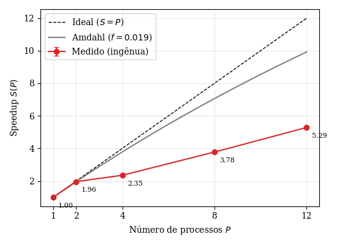

*Figura 1. Speedup da versão ingênua, comparado ao ideal e à Lei de Amdahl.*

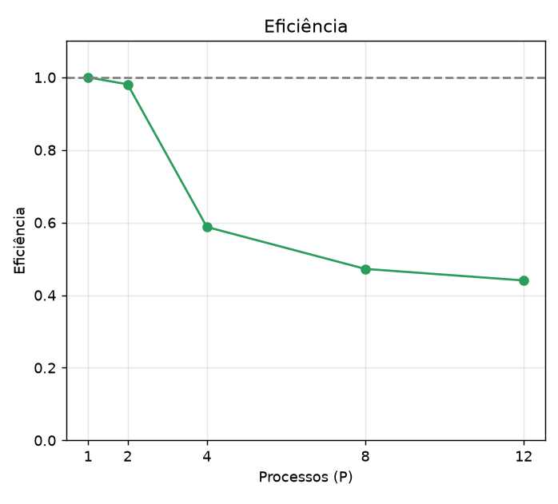

*Figura 2. Eficiência da versão ingênua, comparada ao ideal.*

A Tabela 4 e a Figura 1 mostram que o speedup da versão ingênua acompanha a Lei de Amdahl apenas até $P = 2$ ($S = 1{,}96$, $E = 0{,}98$), onde a carga é simétrica em relação a $\mathrm{Im}(c) = 0$ e $T_{max}/T_{média} = 1{,}00$. A partir de $P = 4$ a eficiência cai para 0,59 e continua diminuindo, chegando a 0,44 em $P = 12$ ($S = 5{,}29$), enquanto Amdahl, com $f = 0{,}019$, prevê $S = 9{,}93$. A diferença coincide com o aumento do desbalanceamento, mostrado na Tabela 5: a decomposição em blocos concentra nos ranks centrais os pixels pertencentes ao conjunto, que consomem as 1500 iterações. O parâmetro $\lambda$ passa de 1,00 em $P = 2$ para 1,65, 1,99 e 2,07 em $P = 4, 8$ e $12$, e em $P = 12$ o rank médio fica ocioso por 52% do tempo de cálculo.

| P | $T_{max}$ | $T_{min}$ | $T_{média}$ | $\lambda$ | Ociosidade média |
|--:|--:|--:|--:|--:|--:|
| 2 | 112,16 | 112,10 | 112,13 | 1,000 | 0% |
| 4 | 92,40 | 19,74 | 56,07 | 1,648 | 39% |
| 8 | 55,82 | 2,88 | 28,03 | 1,991 | 50% |
| 12 | 38,73 | 0,68 | 18,69 | 2,072 | 52% |

*Tabela 5. Desbalanceamento de carga da versão ingênua.*

Como $T_{total} \approx T^{max}_{comp} + T^{max}_{gather}$, o desbalanceamento impõe diretamente o tempo total: em $P = 12$, o rank mais pesado calcula por 38,73 s, enquanto a média é de 18,69 s. Com a carga perfeitamente dividida, o tempo de cálculo seria cerca de metade, e o speedup se aproximaria do previsto por Amdahl (9,93). Esse é o teto que a otimização proposta deve buscar.

### 5.4. Weak scaling

| P | $N_{total}$ (pixels) | $T_{max}$ (s) | $\sigma_T$ | $E_{weak}$ |
|--:|--:|--:|--:|--:|
| 1 | 152.409.600 | 224,25 | 0,001 | 1,000 |
| 2 | 304.819.200 | 228,34 | 0,006 | 0,982 |
| 4 | 609.638.400 | 378,46 | 0,013 | 0,593 |
| 8 | 1.219.276.800 | 463,73 | 0,009 | 0,484 |
| 12 | 1.828.915.200 | 489,96 | 0,081 | 0,458 |

*Tabela 6. Weak scaling da versão ingênua.*

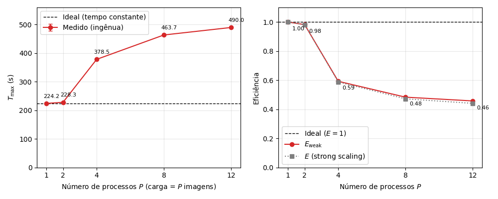

*Figura 3. Weak Scaling: Ingênuo.*

Para verificar que o tempo cresce linearmente com a carga, executou-se $P = 1$ com 2 imagens, que levou 2 vezes o tempo com uma imagem. Assim, qualquer perda de eficiência no *weak scaling* vem da decomposição paralela, e não do desenho do experimento.

Com $P = 2$, o tempo praticamente não muda (228,34 s, $E_{weak} = 0{,}98$), pois a carga é equilibrada. A partir de $P = 4$, o tempo cresce de forma acentuada (378,46 s) e chega a 489,96 s com $P = 12$, mais que o dobro do ideal, com $E_{weak} = 0{,}46$. Os valores de $E_{weak}$ são muito próximos da eficiência do *strong scaling* (0,98, 0,59, 0,47 e 0,44 para $P = 2, 4, 8$ e $12$), e a queda ocorre nos mesmos pontos. Isso indica a mesma causa: como cada imagem é dividida em blocos da mesma forma, o desbalanceamento da Seção 5.3 se repete em todas as $P$ imagens, e o tempo total acompanha o do rank mais pesado. O *weak scaling*, portanto, não revela um comportamento novo, e confirma que o problema não é o tamanho da carga.

### 5.5. Computação versus comunicação

A fração de comunicação $F_{comm}$ (Equação 9) é calculada com as médias entre ranks de $T_{comp}$ e $T_{comm}$. Como $T_{comm}$ acumula todo o tempo dentro de chamadas MPI, ele inclui a espera na barreira anterior ao `MPI_Gatherv` ($T_{wait}$), o próprio `MPI_Gatherv` ($T_{gather}$) e a barreira final ($T_{bar}$). Os resultados estão nas Tabelas 7 e 8.

| P | $T_{comp}$ | $T_{comm}$ | $F_{comm}$ (%) |
|--:|--:|--:|--:|
| 1 | 224,25 | 0,00 | 0,0 |
| 2 | 112,13 | 2,18 | 1,9 |
| 4 | 56,07 | 39,29 | 41,2 |
| 8 | 28,03 | 31,31 | 52,8 |
| 12 | 18,69 | 23,72 | 55,9 |

*Tabela 7. Computação e comunicação na versão ingênua. Tempos em segundos, médias entre ranks e entre as 3 execuções. $F_{comm} = T_{comm}/(T_{comp} + T_{comm})$.*

| P | $T_{wait}$ | $T_{gather}$ | $T_{bar}$ | $F_{gather}$ (%) | $T_{wait}/T_{comm}$ (%) |
|--:|--:|--:|--:|--:|--:|
| 2 | 0,03 | 2,14 | 0,01 | 1,9 | 1,4 |
| 4 | 36,33 | 2,22 | 0,74 | 2,3 | 92,5 |
| 8 | 27,79 | 2,18 | 1,34 | 3,7 | 88,8 |
| 12 | 20,04 | 2,12 | 1,56 | 5,0 | 84,5 |

*Tabela 8. Decomposição de $T_{comm}$ (médias entre ranks, em segundos). $F_{gather} = T_{gather}/T_{total}$; a última coluna é a parcela de $T_{comm}$ que é espera na barreira.*

Pela definição, $F_{comm}$ cresce de 1,9% ($P = 2$) para 55,9% ($P = 12$), o que sugeriria uma comunicação dominante. A Tabela 8 mostra que **não é isso**: de 84% a 93% do $T_{comm}$ para $P \ge 4$ é $T_{wait}$, tempo em que ranks já terminaram o cálculo e esperam o mais lento. É ociosidade causada pelo desbalanceamento (Seção 5.3), e não custo de transferência. Em $P = 2$, onde a carga é equilibrada, $T_{wait}$ é desprezível e $F_{comm}$ coincide com $F_{gather}$.

A Figura 4 exemplifica de forma visual o impacto do desbalanceamento na etapa de comunicação: enquanto a fração do $T_{gather}$ se mantém, o $T_{wait}$ cresce junto com $P$. Assim, a comunicação em si é um custo secundário nesta versão.

Logo, o principal problema é a espera causada pelo desbalanceamento, que nenhuma melhoria focada em otimizar a comunicação resolveria.

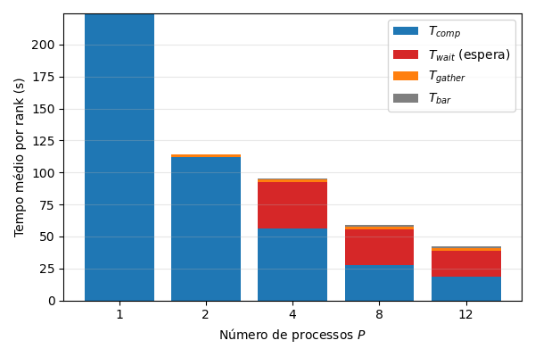

*Figura 4. Comunicação × Computação: Ingênuo.*

### 5.6. Análise de balanceamento de carga

A perda de escalabilidade na versão ingênua decorre diretamente da interação entre a geometria do conjunto de Mandelbrot e a decomposição estática em blocos contíguos. A cardioide principal e o bulbo periódico à sua esquerda concentram-se em torno do eixo real ($\mathrm{Im}(c) = 0$), que corresponde à faixa horizontal central da imagem. Nessa região, os pontos pertencem ao conjunto e não divergem ($|z| \le 2$), forçando o laço interno a executar a totalidade das 1500 iterações por pixel. Nas faixas superior e inferior ($\mathrm{Im}(c) \to \pm 1$), em contrapartida, os pontos escapam do raio de convergência em poucas iterações.

Na decomposição em blocos com $P = 2$, o corte horizontal ocorre exatamente sobre a linha central ($\mathrm{Im}(c) = 0$). Devido à simetria conjugada do fractal ($\overline{z^2 + c} = \bar{z}^2 + \bar{c}$), a metade superior (rank 0) e a metade inferior (rank 1) possuem custos computacionais idênticos, resultando em $T_{max} = 112{,}16$ s, $T_{min} = 112{,}10$ s e $\lambda = 1{,}000$ (Tabela 5.3). Contudo, para $P \ge 4$, a imagem é fatiada em tiras horizontais que isolam o centro denso das bordas leves:

- Em $P = 4$, os dois ranks centrais processam toda a região densa do fractal ($T_{max} = 92{,}40$ s), enquanto os dois ranks das extremidades concluem suas faixas em $T_{min} = 19{,}74$ s ($\sigma_{ranks} = 36{,}31$ s e $\lambda = 1{,}648$).
- Em $P = 8$ e $P = 12$, o estreitamento das faixas agrava essa assimetria: para $P = 12$, um rank periférico finaliza seu bloco em apenas 0,68 s, ao passo que o rank central demanda 38,73 s — uma razão extrema de $T_{max}/T_{min} \approx 57$ vezes ($\lambda = 2{,}072$).

A adoção da decomposição cíclica (*round-robin*) elimina essa concentração espacial ao intercalar a atribuição das linhas ($i = r + kP$). Como a variação de complexidade entre linhas adjacentes da imagem (10080 linhas no total) é suave, todos os $P$ processos amostram uniformemente tanto as regiões periféricas de escape rápido quanto o núcleo denso do conjunto. A Tabela 9 apresenta as métricas de tempo de computação ($T_{comp}$) obtidas com a abordagem cíclica ao lado do fator de desbalanceamento $\lambda$ da versão ingênua.

| P | $T_{max}$ (s) | $T_{min}$ (s) | $T_{média}$ (s) | $\sigma_{ranks}$ (s) | $\lambda_{otim}$ | $\lambda_{ingênuo}$ |
|--:|--:|--:|--:|--:|--:|--:|
| 1 | 224,301 | 224,301 | 224,301 | 0,000 | 1,000 | 1,000 |
| 2 | 112,180 | 112,154 | 112,167 | 0,013 | 1,000 | 1,000 |
| 4 | 56,097 | 56,070 | 56,081 | 0,010 | 1,000 | 1,648 |
| 8 | 28,057 | 28,035 | 28,040 | 0,007 | 1,001 | 1,991 |
| 12 | 18,709 | 18,689 | 18,693 | 0,006 | 1,001 | 2,072 |

*Tabela 9. Balanceamento de carga ($T_{comp}$) na versão otimizada.*

Os dados da Tabela 9 demonstram que o desvio padrão entre ranks ($\sigma_{ranks}$) na versão otimizada não ultrapassa 13 ms em nenhuma configuração, caindo para 6 ms em $P = 12$ (frente a 13,56 s na divisão em blocos). Para $P = 12$, a diferença absoluta entre o processo mais lento (18,709 s) e o mais rápido (18,689 s) reduz-se a apenas 20 ms, mantendo a carga computacional de cada nó colada à média teórica (18,693 s).

Esse equilíbrio estatístico reflete-se diretamente na evolução do fator $\lambda = T_{max}/T_{média}$ ilustrada na Figura 5. Enquanto a curva da versão sem balanceamento (em vermelho) diverge rapidamente da linha tracejada ideal a partir de $P = 4$ até atingir 2,07 em $P = 12$ — indicando que o rank crítico trabalha mais que o dobro da média do *cluster* —, a curva da versão balanceada (em azul) permanece sobreposta ao limite ideal ($\lambda = 1{,}00$) em toda a faixa avaliada, erradicando a ociosidade de CPU antes da etapa de comunicação.

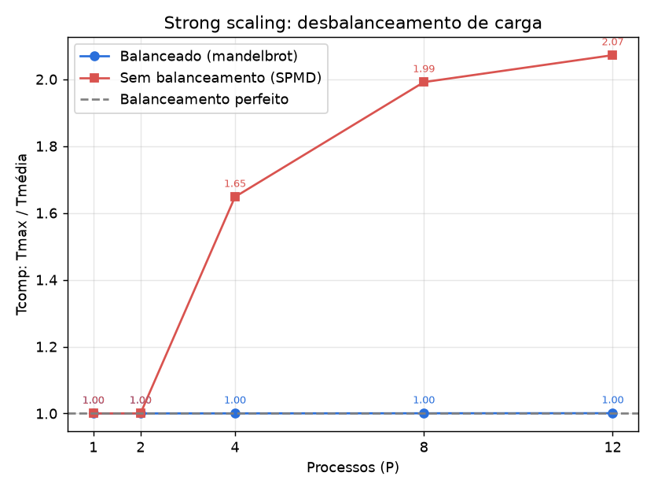

*Figura 5. Fator de desbalanceamento ($\lambda$) por número de processos.*

### 5.7. Otimização Proposta e comparações com versão Ingênua

Com a eliminação da assimetria de carga pelo mapeamento cíclico, o tempo total de execução passa a refletir o poder de processamento agregado dos nós e o custo efetivo da rede. A Tabela 10 reúne as estatísticas detalhadas de $T_{comp}$, $T_{comm}$ e $T_{total}$ medidas com `MPI_Wtime` na versão otimizada.

| P | Métrica | $T_{max}$ (s) | $T_{min}$ (s) | $T_{média}$ (s) | $\sigma_{ranks}$ (s) |
|--:|:--|--:|--:|--:|--:|
| 1 | $T_{comp}$ | 224,301 | 224,301 | 224,301 | 0,000 |
| | $T_{comm}$ | 0,000 | 0,000 | 0,000 | 0,000 |
| | $T_{total}$ | 224,301 | 224,301 | 224,301 | 0,000 |
| 2 | $T_{comp}$ | 112,180 | 112,154 | 112,167 | 0,013 |
| | $T_{comm}$ | 2,212 | 2,023 | 2,117 | 0,094 |
| | $T_{total}$ | 114,372 | 114,370 | 114,371 | 0,001 |
| 4 | $T_{comp}$ | 56,097 | 56,070 | 56,081 | 0,010 |
| | $T_{comm}$ | 3,132 | 2,972 | 3,087 | 0,067 |
| | $T_{total}$ | 59,203 | 59,202 | 59,203 | 0,000 |
| 8 | $T_{comp}$ | 28,057 | 28,035 | 28,040 | 0,007 |
| | $T_{comm}$ | 3,679 | 3,524 | 3,656 | 0,050 |
| | $T_{total}$ | 31,714 | 31,713 | 31,714 | 0,000 |
| 12 | $T_{comp}$ | 18,709 | 18,689 | 18,693 | 0,006 |
| | $T_{comm}$ | 3,778 | 3,621 | 3,762 | 0,043 |
| | $T_{total}$ | 22,468 | 22,466 | 22,467 | 0,001 |

*Tabela 10. Tempos por rank com `MPI_Wtime` na versão otimizada.*

Diferentemente do que ocorria na Tabela 5.2 (versão ingênua), na qual $T_{comm}$ apresentava desvios de até 36,31 s entre os processos devido à espera na barreira, a Tabela 10 revela que tanto $T_{comp}$ quanto $T_{comm}$ possuem valores máximos e mínimos praticamente idênticos em todos os ranks ($\sigma_{ranks} \le 0{,}094$ s). Isso comprova que todos os nós encerram a fase de cálculo de forma síncrona e iniciam a operação coletiva `MPI_Gatherv` sem atrasos acumulados.

#### 5.7.1. Impacto no Strong Scaling

Para quantificar o ganho de escalabilidade forte, a Tabela 11 confronta o tempo paralelo ($T^{otim}_{max}$), o speedup e a eficiência da versão otimizada com os resultados da versão ingênua e com o limite teórico da Lei de Amdahl ($f = 0{,}019$).

| P | $T^{otim}_{max}$ (s) | $\sigma_{rep}$ (s) | $S_{otim}$ | $S_{ingênuo}$ | $S_{Amdahl}$ | $E_{otim}$ | $E_{ingênuo}$ |
|--:|--:|--:|--:|--:|--:|--:|--:|
| 1 | 224,301 | 0,004 | 1,000 | 1,000 | 1,00 | 1,000 | 1,000 |
| 2 | 114,372 | 0,015 | 1,961 | 1,962 | 1,96 | 0,981 | 0,981 |
| 4 | 59,203 | 0,011 | 3,789 | 2,352 | 3,78 | 0,947 | 0,588 |
| 8 | 31,714 | 0,129 | 7,073 | 3,779 | 7,06 | 0,884 | 0,472 |
| 12 | 22,468 | 0,005 | 9,983 | 5,288 | 9,93 | 0,832 | 0,441 |

*Tabela 11. Comparação de strong scaling entre as versões.*

Analisando isoladamente a componente de computação na Tabela 10, nota-se que $T^{max}_{comp}$ cai de 224,301 s ($P = 1$) para 18,709 s ($P = 12$), alcançando um speedup estritamente computacional de $224{,}301 / 18{,}709 = 11{,}989$ em 12 processos. Quando se considera o tempo total da região paralela na Tabela 11 ($T^{otim}_{max} = 22{,}468$ s em $P = 12$, frente a 42,41 s na ingênua), a decomposição cíclica reduz o tempo de execução em **47%** e eleva o speedup global de 5,288 para **9,983**.

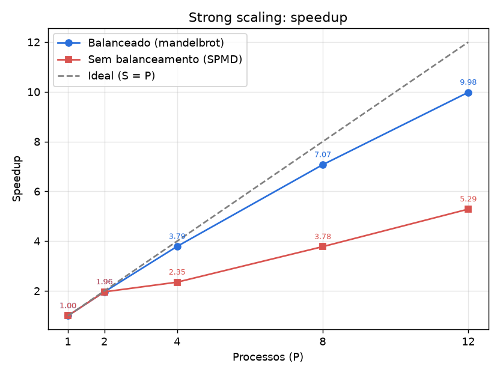

*Figura 6. Comparação de speedup.*

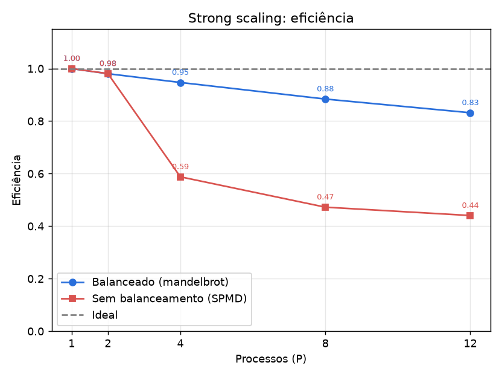

*Figura 7. Comparação de eficiência.*

As Figuras 6 e 7 evidenciam visualmente essa mudança de regime no strong scaling. Na Figura 6, enquanto a versão sem balanceamento sofre forte inflexão em $P = 4$ ($S = 2{,}35$) e se afasta da reta ideal, a versão balanceada cresce de maneira consistente ($S = 3{,}79$ em $P = 4$ e $S = 7{,}07$ em $P = 8$) e crava a previsão teórica da Lei de Amdahl ($S_{Amdahl} = 9{,}93$ em $P = 12$), confirmando a hipótese levantada na Seção 5.3. De forma complementar, a Figura 7 mostra que a eficiência ($E = S/P$) na abordagem em blocos despenca para 59% ($P = 4$) e termina em 44% ($P = 12$), desperdiçando mais da metade dos ciclos do cluster. Já na versão cíclica (curva azul), a eficiência preserva-se em 95% ($P = 4$), 88% ($P = 8$) e 83% ($P = 12$), sendo a redução residual de 17% explicada exclusivamente pela etapa sequencial de coleta via rede.

#### 5.7.2. Impacto na Comunicação

A supressão do tempo de espera em barreira ($T_{wait}$) altera radicalmente as métricas de comunicação do algoritmo. A Tabela 12 contrasta os tempos médios e máximos de comunicação da versão otimizada com a fração de comunicação de ambas as abordagens.

| P | $T^{médio}_{comp}$ (s) | $T^{médio}_{comm}$ (s) | $T^{max}_{comm}$ (s) | $F^{otim}_{comm}$ (%) | $F^{ingênuo}_{comm}$ (%) |
|--:|--:|--:|--:|--:|--:|
| 1 | 224,301 | 0,000 | 0,000 | 0,00 | 0,0 |
| 2 | 112,167 | 2,117 | 2,212 | 1,93 | 1,9 |
| 4 | 56,081 | 3,087 | 3,132 | 5,29 | 41,2 |
| 8 | 28,040 | 3,656 | 3,679 | 11,60 | 52,8 |
| 12 | 18,693 | 3,762 | 3,778 | 16,82 | 55,9 |

*Tabela 12. Computação versus comunicação na versão otimizada.*

Nota-se na Tabela 12 que o tempo médio de comunicação $T^{médio}_{comm}$ na versão otimizada é quase idêntico ao tempo máximo $T^{max}_{comm}$ e cresce de forma suave: passa de 2,117 s em $P = 2$ para 3,762 s em $P = 12$. Esse valor representa o tempo real de transmissão na rede Ethernet para agregar os ≈ 457 MB da imagem ($152{,}4 \times 10^6$ pixels × 3 bytes RGB) no processo raiz por meio da primitiva `MPI_Gatherv`.

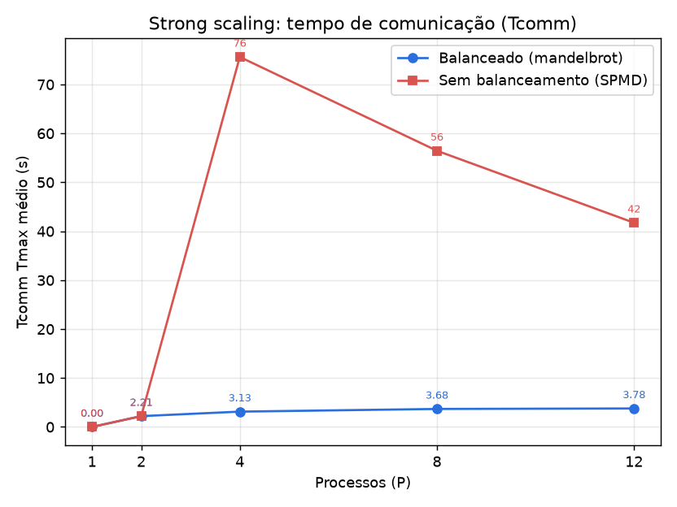

*Figura 8. Tempo máximo ($T^{max}_{comm}$).*

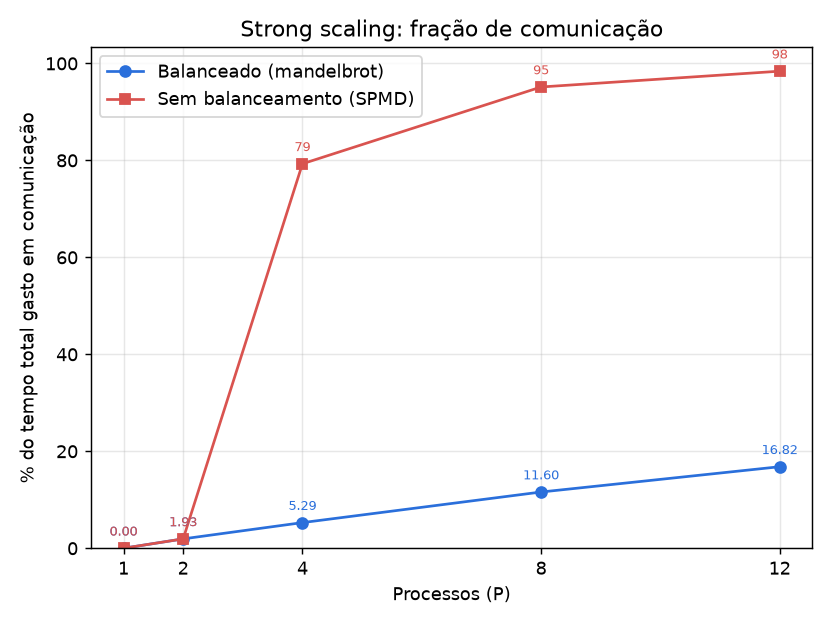

*Figura 9. Fração de comunicação.*

O contraste visual nas Figuras 8 e 9 ilustra a diferença entre sincronização forçada por desbalanceamento e comunicação efetiva. Na Figura 8, enquanto na versão ingênua a curva vermelha de $T^{max}_{comm}$ salta para 75,62 s em $P = 4$ e permanece em 41,73 s em $P = 12$ (pois o rank mais leve fica retido na barreira aguardando o término do rank central), na versão balanceada a curva azul mantém-se praticamente plana abaixo de 3,8 s para qualquer quantidade de nós. Na Figura 9, observa-se que o pior rank da versão sem balanceamento chega a despender 79% ($P = 4$), 95% ($P = 8$) e 98% ($P = 12$) de todo o seu tempo aguardando em chamadas MPI (média de 55,9% na Tabela 12). Na versão otimizada, a fração de comunicação cai para apenas 5,29% ($P = 4$), 11,60% ($P = 8$) e 16,82% ($P = 12$), crescimento gradual decorrente do encolhimento de $T_{comp}$ proporcional a $1/P$ frente ao volume fixo de ≈ 457 MB trafegados no `MPI_Gatherv`. Destaca-se ainda que o reordenamento das linhas na memória RAM do rank 0 antes da escrita em disco envolve apenas cópias locais em memória, não introduzindo gargalo perceptível frente aos quase 20 s economizados no cálculo paralelo.

#### 5.7.3. Impacto no Weak Scaling

Por fim, avalia-se a escalabilidade fraca (*weak scaling*) da versão otimizada, na qual a carga total cresce proporcionalmente ao número de processos ($P$ imagens de 152,4 Mpx processadas sequencialmente, mantendo 1 imagem equivalente de trabalho por processo). A Tabela 13 sumariza os tempos obtidos, a divisão entre computação e comunicação e a eficiência fraca resultante.

| P | Imagens ($N_{total}$) | $T_{max}$ (s) | $\sigma_{rep}$ (s) | $T^{médio}_{comp}$ (s) | $T^{médio}_{comm}$ (s) | $F_{comm}$ (%) | $E^{otim}_{weak}$ |
|--:|:--|--:|--:|--:|--:|--:|--:|
| 1 | 1 (152 Mpx) | 224,302 | 0,004 | 224,302 | 0,000 | 0,00 | 1,000 |
| 2 | 2 (305 Mpx) | 265,980 | 64,744 | 224,289 | 41,552 | 12,65 | 0,843 |
| 4 | 4 (610 Mpx) | 236,675 | 0,015 | 224,267 | 12,275 | 5,25 | 0,948 |
| 8 | 8 (1.219 Mpx) | 252,973 | 0,128 | 224,267 | 28,575 | 11,36 | 0,887 |
| 12 | 12 (1.829 Mpx) | 269,261 | 0,110 | 224,262 | 44,867 | 16,72 | 0,833 |

*Tabela 13. Resultados de weak scaling da versão otimizada.*

Os resultados da Tabela 13 mostram que o tempo médio de computação ($T^{médio}_{comp}$) permanece rigorosamente constante em torno de 224,27 s desde $P = 1$ (152 Mpx) até $P = 12$ (1,829 bilhão de pixels). Isso demonstra que a decomposição cíclica distribui cada uma das $P$ imagens de forma uniforme entre os nós.

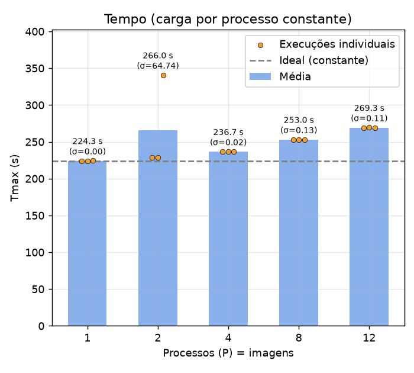

*Figura 10. Tempo total no weak scaling.*

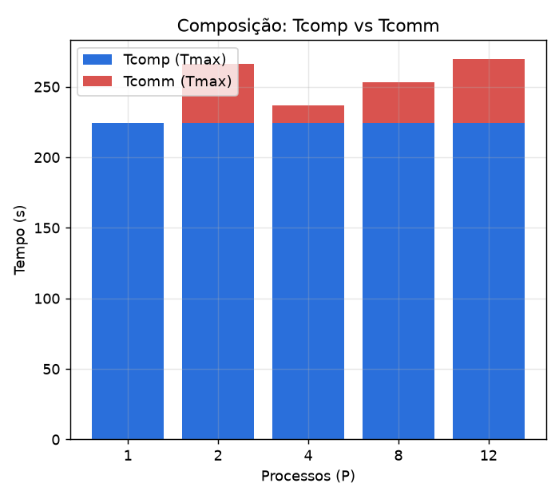

*Figura 11. Composição ($T_{comp}$ vs. $T_{comm}$).*

As Figuras 10 e 11 detalham a evolução temporal do experimento de escalabilidade fraca. Na Figura 10, observa-se a relação entre as médias de $T_{max}$ (barras azuis) e as execuções individuais (pontos laranjas). Nota-se em $P = 2$ uma elevação atípica da média para 265,980 s ($\sigma_{rep} = 64{,}744$ s): enquanto duas das três repetições registraram ≈ 228,6 s (alinhadas ao patamar ideal tracejado), uma única execução sofreu uma instabilidade transitória na rede durante o `MPI_Gatherv` (≈ 340 s), puxando a média de $T_{comm}$ em $P = 2$ para 41,552 s. Para $P \in \{4, 8, 12\}$, as execuções apresentaram altíssima estabilidade ($\sigma_{rep} \le 0{,}128$ s). Na Figura 11, verifica-se que a base azul de $T_{comp}$ mantém-se estática em 224,3 s em todas as configurações, enquanto a parcela superior vermelha de $T_{comm}$ cresce linearmente de 12,275 s ($P = 4$) para 28,575 s ($P = 8$) e 44,867 s ($P = 12$). Como o algoritmo realiza um `MPI_Gatherv` ao término de cada uma das $P$ imagens, o custo unitário de coleta é de 3,07 s ($P = 4$), 3,57 s ($P = 8$) e 3,74 s ($P = 12$) por imagem, valores consistentes com os medidos para uma única imagem no *strong scaling* (Tabela 12).

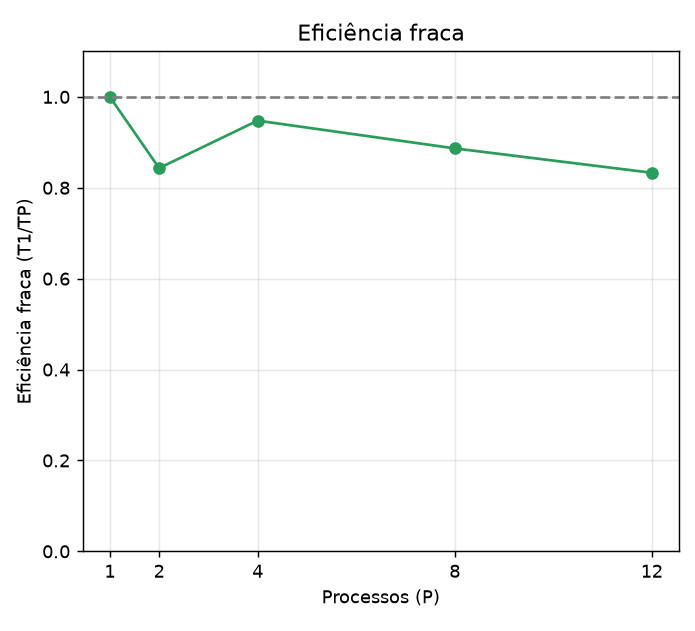

*Figura 12. Eficiência fraca ($E_{weak}$) da versão otimizada.*

Por fim, a Figura 12 apresenta o impacto desse comportamento na curva de eficiência fraca ($E_{weak} = T(1)/T(P)$). Desconsiderando a flutuação pontual de rede em $P = 2$ ($E_{weak} = 0{,}843$ na média das três execuções, mas ≈ 0,98 nas duas execuções normais), a curva segue uma trajetória suave de 94,8% em $P = 4$, 88,7% em $P = 8$ e 83,3% em $P = 12$ (269,261 s). Comparada à versão ingênua — cuja eficiência fraca caía para 45,8% em $P = 12$ com tempo total de 489,96 s (Tabela 5.4) —, a versão otimizada proporciona um ganho de 37,5 pontos percentuais em eficiência e reduz o tempo de processamento de 12 imagens em 220,7 s. Aplicando a Lei de Gustafson (Equação 7) com a fração de comunicação medida em $P = 12$ ($\alpha = F_{comm}(12) = 0{,}1672$), obtém-se um speedup escalado de

$$S_G(12) = 12 - 0{,}1672 \times 11 = 10{,}16,$$

demonstrando elevada escalabilidade para cargas de trabalho massivas.

### 5.8. Comparação OpenMP vs. MPI

A avaliação do paradigma de paralelismo com memória distribuída via MPI em comparação ao paradigma de memória compartilhada via OpenMP exige uma distinção rigorosa entre a análise conceitual e a análise quantitativa.

#### 5.8.1. Ressalva Metodológica e Experimental

Sob a perspectiva experimental, uma comparação quantitativa direta de desempenho (médias de tempo absoluto e curvas de *speedup*) entre os resultados de OpenMP e os de MPI obtidos neste estudo **não é metodologicamente científica**. Isso ocorre devido à alteração de variáveis essenciais de controle entre os dois cenários:

1. **Divergência de Hardware:** Os experimentos OpenMP foram executados em uma arquitetura de máquina isolada, cujas taxas de transferência de barramento, hierarquia de *cache* e número de *cores* físicos diferem da infraestrutura de *cluster* utilizada para o MPI (composta por nós heterogêneos/dedicados conectados via rede);
2. **Volume de Dados ($N$):** O tamanho do problema e o domínio das imagens geradas para a análise do conjunto de Mandelbrot sofreram alteração, invalidando a correlação direta de escalabilidade relativa e tempos absolutos de processamento;
3. **Mecanismo de Controle de Carga:** Enquanto o OpenMP utiliza o escalonamento dinâmico ou guiado de *threads* gerenciado diretamente na memória RAM, o MPI exige decomposição explícita de domínio e controle manual via *ranks*.

Dessa forma, qualquer comparação numérica direta constituiria uma falácia metodológica. Assim, a comparação restringe-se primariamente ao âmbito qualitativo e arquitetural, complementada por uma análise comportamental das tendências de escalabilidade obtidas a partir das medições empíricas de ambas as abordagens.

#### 5.8.2. Análise Qualitativa dos Paradigmas

A Tabela 14 detalha as diferenças fundamentais entre os modelos de memória compartilhada (OpenMP) e memória distribuída (MPI).

| Critério | OpenMP (Compartilhada) | MPI (Distribuída) |
|:--|:--|:--|
| **Modelo de memória** | Compartilhada (RAM global) | Distribuída (privada por rank) |
| **Escopo de execução** | Intra-nó (núcleos de um host) | Inter-nó (múltiplos nós em cluster) |
| **Custo de criação** | Baixo (*threads* leves) | Alto (processos pesados do SO) |
| **Comunicação** | Acesso direto à memória | Passagem de mensagens explícita |
| **Latência relativa** | Muito baixa (ordem de ns) | Média/Alta (ordem de µs a ms) |
| **Escalabilidade típica** | Limitada ao nó (cores locais) | Alta (milhares de nós/processos) |
| **Estilo de código** | Diretivas (`#pragma omp`) | Chamadas de biblioteca |

*Tabela 14. Comparação qualitativa e arquitetural entre OpenMP e MPI.*

A principal distinção reside na visibilidade e acesso ao espaço de endereçamento. No OpenMP, todos os *threads* acessam o mesmo espaço global de RAM, permitindo troca implícita e de altíssima velocidade via barramento da placa-mãe. Em contrapartida, no MPI cada processo possui seu próprio espaço de endereçamento isolado; qualquer troca de informação necessita da construção, empacotamento e envio explícito de mensagens pela rede de interconexão (*sockets*/Ethernet/InfiniBand), gerando uma latência ordens de grandeza superior (µs a ms contra ns).

Por outro lado, o modelo de memória compartilhada do OpenMP é estritamente limitado pela capacidade física de um único nó *host* (geralmente de dezenas a poucas centenas de *cores*). Já o paradigma de passagem de mensagens do MPI oferece escalabilidade massiva, permitindo que o algoritmo de Mandelbrot execute em milhares de nós de cômputo distribuídos nos maiores supercomputadores do mundo [TOP500 2026].

#### 5.8.3. Análise Comportamental do Speedup

Embora existam limitações na comparação direta de desempenho devido aos diferentes hardwares e parâmetros de entrada, a Figura 13 ilustra o comportamento comparativo das curvas de *speedup* obtidas utilizando os tempos registrados nos relatórios de execução do OpenMP ($P \in \{1, 2, 4, 8\}$) e os tempos consolidados da versão MPI otimizada ($P \in \{1, 2, 4, 8, 12\}$).

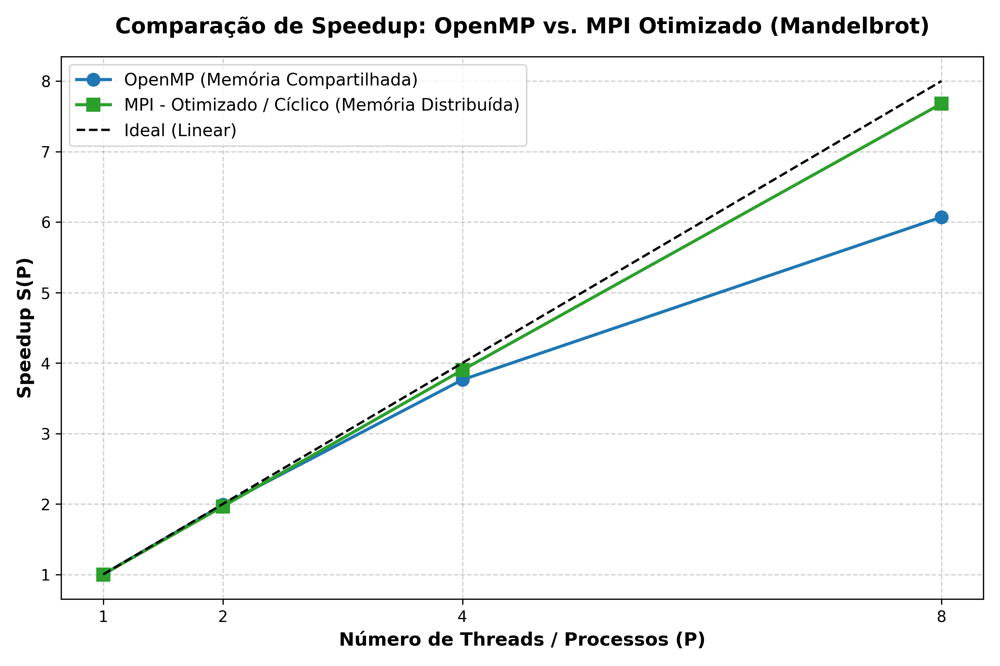

*Figura 13. Comparação comportamental do speedup entre o OpenMP (obtido via `clock_gettime`) e a versão MPI otimizada (obtida via `MPI_Wtime`) para o cálculo do conjunto de Mandelbrot.*

Observa-se que tanto o OpenMP quanto a versão MPI otimizada (com balanceamento de carga cíclico) apresentam boa aderência ao crescimento linear esperado. Observa-se que o MPI atingiu um speedup maior que a versão do OpenMP, mas essa diferença não pode ser analisada de maneira quantitativa, tendo em vista que existem muitas divergências entre as versões, diferenças de ambiente de execução, volume de dados e metodologia de divisão de trabalho. Dessa forma, é possível apenas observar o comportamento e avaliar qualitativamente as duas abordagens de paralelização.

#### 5.8.4. O Paradigma Híbrido (MPI + OpenMP)

Em sistemas de Computação de Alto Desempenho (HPC) de grande porte, como os catalogados no TOP500 [TOP500 2026], os modelos de memória compartilhada e distribuída não competem, mas se complementam no paradigma híbrido (MPI + OpenMP).

Nessa abordagem combinada:

- O **MPI** é empregado no nível superior (*inter-nó*), coordenando a distribuição dos blocos ou linhas do conjunto de Mandelbrot entre os diferentes nós do *cluster* via rede;
- O **OpenMP** atua no nível inferior (*intra-nó*), instanciando *threads* para paralelizar o cálculo iterativo do fractal entre os diversos núcleos processadores de cada nó individual, explorando diretamente a memória RAM compartilhada local.

Essa estratégia reduz drasticamente a sobrecarga (*overhead*) de mensagens na rede e o número de *ranks* MPI necessários, maximizando a eficiência energética e o aproveitamento da hierarquia de *cache* dos processadores modernos.

---

## 6. Conclusão

Este trabalho investigou o impacto do esquema de decomposição de domínio no desempenho de uma aplicação MPI para a geração do conjunto de Mandelbrot (imagem de 15120 × 10080 pixels e 1500 iterações) em um cluster de memória distribuída com até 12 nós. Comparou-se a decomposição em blocos contíguos (ingênua) com a decomposição cíclica (*round-robin*), ambas validadas pixel a pixel contra a versão serial ($T_{serial} = 224{,}27$ s).

Os resultados mostraram que a versão ingênua escala mal: a eficiência caiu para 0,44 em $P = 12$ ($S = 5{,}29$, contra 9,93 previstos por Amdahl com $f = 0{,}019$). A causa não foi a rede, mas o desbalanceamento de carga: com $\lambda = 2{,}07$, de 84% a 93% do $T_{comm}$ para $P \ge 4$ correspondia à espera em barreira ($T_{wait}$), e não à transferência de dados.

O mapeamento cíclico eliminou esse problema ($\lambda \le 1{,}001$ em todos os casos), elevando o speedup em $P = 12$ para 9,98 (eficiência de 0,83) e reduzindo o tempo paralelo de 42,41 s para 22,47 s, ganho de 47%. No *weak scaling*, a eficiência em $P = 12$ subiu de 0,46 para 0,83, e o speedup escalado de Gustafson ($S_G(12) = 10{,}16$) confirmou a boa escalabilidade para cargas crescentes.

Algumas lições merecem destaque:

- **Dividir dados igualmente não é dividir trabalho igualmente.** Em problemas com custo irregular por elemento, a decomposição por domínio precisa considerar o custo computacional, e não apenas o número de elementos. Uma solução estática e sem comunicação (cíclica) bastou, dispensando a complexidade do modelo mestre-trabalhador.
- **Métricas agregadas podem enganar.** A fração $F_{comm}$ de 55,9% sugeria comunicação dominante, mas a decomposição de $T_{comm}$ revelou que se tratava de ociosidade. Instrumentar separadamente computação, espera e transferência foi essencial para o diagnóstico correto, algo que o utilitário `time` não permite.
- **A comunicação passa a ser o próximo gargalo.** Na versão otimizada, o `MPI_Gatherv` (cerca de 457 MB) consome de 2,1 s a 3,8 s, e sua fração cresce de 1,9% ($P = 2$) para 16,8% ($P = 12$) à medida que $T_{comp}$ diminui com $1/P$. Esse custo, somado ao reordenamento serial no rank 0, explica a eficiência residual de 83% e indica o limite de Amdahl da aplicação.
- **Rigor experimental.** A repetição de cada experimento revelou, por exemplo, uma instabilidade de rede em uma das execuções de $P = 2$ no *weak scaling* ($\sigma_{rep} = 64{,}74$ s), mostrando a importância de reportar a variabilidade entre execuções. Também ficou claro que a comparação direta com OpenMP exige ambientes e cargas equivalentes, sendo aqui apenas qualitativa.

### Trabalhos futuros

1. A implementação de um modelo híbrido MPI+OpenMP, com MPI entre nós e OpenMP em cada nó, reduzindo o número de ranks e o volume de mensagens;
2. A redução do custo de coleta, por exemplo com E/S paralela (MPI-IO) para que cada rank escreva sua parte diretamente, eliminando o `MPI_Gatherv` e o reordenamento serial no rank 0;
3. A implementação e medição do modelo mestre-trabalhador, que neste estudo foi apenas considerado, para comparar o balanceamento dinâmico com o estático; e
4. A repetição dos experimentos com mais nós e em ambiente idêntico ao do OpenMP, permitindo uma comparação quantitativa justa entre os paradigmas.

---

## Referências

- Duarte, A. *MPI - Message Passing Interface: Computação de Alto Desempenho*. Universidade Estadual de Feira de Santana (UEFS), Feira de Santana/BA. Apresentação em slides.
- Duarte, A. *MPI - Comunicação: Computação de Alto Desempenho*. Universidade Estadual de Feira de Santana (UEFS), Feira de Santana/BA. Apresentação em slides.
- Gustafson, J. L. (1988). *Reevaluating Amdahl's law*. Communications of the ACM, v. 31, n. 5, p. 532–533. Disponível em: <https://doi.org/10.1145/42411.42415>. Acesso em: 26 out. 2026.
- HPC Wiki (2026). *MPI*. Disponível em: <https://hpc-wiki.info/hpc/MPI>. Acesso em: 05 out. 2026.
- TOP500 (2026). *TOP500 Supercomputer Sites*. Disponível em: <https://top500.org/>. Acesso em: 27 out. 2026.
- Wikipedia (2026). *Conjunto de Mandelbrot*. Wikimedia Foundation. Disponível em: <https://pt.wikipedia.org/wiki/Conjunto_de_Mandelbrot>. Acesso em: 18 ago. 2026.
